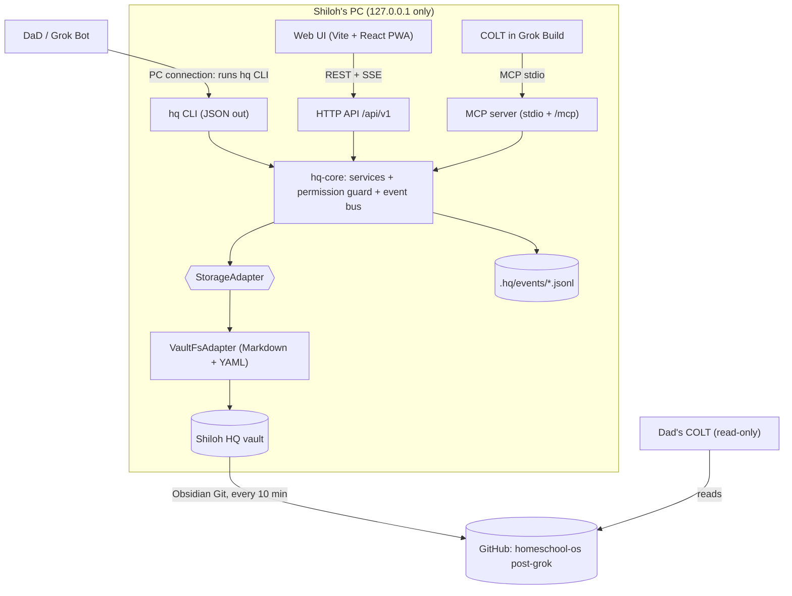

# HQ Dashboard: web-app research, recommendation, build plan

Companion to [[dashboard-product-spec]] (what and why), [[dashboard-agent-contract]] (the API agents use), and [[co-build-guide]] (how Shiloh builds it). **Nothing is installed or built yet** (Node.js LTS is already on the PC; the app is not). Formal `decision:` on [[20261124-learning-dashboard]] is still pending Dad in Obsidian. Chat decisions of 2026-11-24 are in §10 below and in the spec §12.

## 1. Requirements that drive the architecture
1. **The vault stays the source of truth.** Markdown + YAML in `Shiloh HQ`, synced by Obsidian Git ([[DECISIONS]] 2026-11-22: vault-first).
2. **Agent-first.** The UI, COLT (Grok Build on the PC) and Grok Bots (DaD; Dad's Chief-of-Staff COLT) all read and write **the same data through the same rules**.
3. **Hard permissions.** No agent can set `verified`, `verified_by`, `verified_on`, `decision`, readiness 🟢, or write [[verifications]], whatever its prompt says.
4. **Swappable storage.** The vault today; maybe a hosted DB for the Venture product later, without rewriting the app.
5. **Clonable per learner** (the younger brother).
6. Small, cheap, private, and runs on a Windows PC with no cloud account.

## 2. Options compared
| Option | How it works | Agent access | Permission enforcement | Fit |
|---|---|---|---|---|
| **A. Local core server + web UI (recommended)** | A small Node/TypeScript service on the PC reads and writes the vault folder. A Vite + React UI is served from it at `http://127.0.0.1:4317`. The same core is also exposed as MCP and as a CLI. | **Best.** MCP for COLT and Grok Build, CLI or HTTP for Grok Bot via the PC connection, REST for the UI. | **In one place**, the core guard | ✅ Vault-first, agent-first, no plugins, works offline |
| B. Browser-only, File System Access API | The web page asks for the vault folder and writes files directly | **None.** Agents can't call a browser tab. | Only in UI code (bypassable) | ❌ Chromium-only (no Firefox or Safari/iPad), and every agent would need its own parser |
| C. Obsidian plugin / custom view | A dashboard pane inside Obsidian | Poor. Needs Obsidian open. | Inside plugin code only | ⚠ Dad chose "no new community plugins". Fine later as a thin client of A. |
| D. Obsidian Local REST API plugin | Community plugin exposes `/vault/{path}` GET/PUT/PATCH (incl. frontmatter PATCH) and an MCP endpoint | Good, but raw file-level | **None field-level.** Any key holder can PATCH `verified`. | ❌ Violates the permission requirement. Another plugin. Obsidian must be running. |
| E. Static site + git | Build HTML from the vault (like today's `scripts/build_dashboard.py`). Edits go through git. | Read-only | n/a | ⚠ Great for Dad's remote read-only view. No timers or check-offs. |
| F. Hosted (Supabase / Firebase) + vault sync | A cloud DB is primary, synced to Markdown | Good (cloud API) | DB row-level rules | ❌ Two sources of truth, a minor's data in the cloud, and a repeat of the parked Next.js + Supabase app. Keep as a **future adapter** for the Venture product only. |
| G. Tauri desktop app | Native shell around A's UI, with the core as a sidecar | Same as A | Same as A | ✅ Later (v2), as packaging for the brother's PC: one installer, no Node install |
| H. PWA for tablet/phone | A's UI installable on a phone or tablet over home Wi-Fi | via A | via A | ✅ v1.5, with a pairing code and LAN only |

**Recommendation: A, packaged later as G, with E kept for Dad's remote read-only view and C optional.** It is the only option where one permission guard protects every path (UI, MCP, CLI, HTTP). The vault stays plain Markdown, the agents get first-class tools, and nothing leaves the house.

## 3. Architecture

- **hq-core** is plain TypeScript with no web framework. Services: `tasks`, `timer`, `evidence`, `notes`, `missions`, `progress`, `suggest`, `review`. Every mutation goes through `guard.check(principal, action, target, patch)`, then the adapter, then an `events.append`.
- **Three faces, one core.** The REST API (UI), the MCP server (agents with MCP), and the `hq` CLI (any agent that can run a command, including Grok Bot through the PC connection). They share zod schemas, so the docs, the validation and the MCP tool schemas never drift.
- **Event bus.** Every change is appended to `.hq/events/YYYY-MM.jsonl` and pushed to the UI over SSE. MCP clients can subscribe through MCP notifications. Agents catch up with `events_since(cursor)`.
- **File watcher** (chokidar). Edits in Obsidian, or by COLT writing files directly, show up in the UI within a second and are logged as `file.changed` (actor `external`).

## 4. Tech stack
| Layer | Choice | Why |
|---|---|---|
| Runtime | Node.js 22 LTS + TypeScript | One language for UI, core, CLI and MCP. Agents and Cursor know it well. Shiloh can learn it ([[playbook-prototype-cursor]]). |
| UI | Vite + React 19 + TypeScript, CSS variables for the Quiet Charter tokens ([[17-command-center-ui-build-brief\|Doc 17]]), Lora + Public Sans (self-hosted fonts, no CDN). My Day adds a path, XP bar, mascot, and a short CSS celebration. Headmaster is a denser board layout. | Doc 17 suggested Next.js for a hosted app. A local app doesn't need SSR, and Vite is lighter. Same tokens, two faces (spec §4.1 and §5.7). |
| Local server | Hono (or Express) on `127.0.0.1:4317`, SSE for live updates | Small, typed, binds to loopback |
| Markdown/YAML | `gray-matter` + `yaml` (frontmatter), `remark` / mdast for section and table edits, exact-line patching for checkboxes | Minimal diffs, formatting kept |
| Validation | `zod` schemas shared by API, MCP and CLI | One contract |
| MCP | `@modelcontextprotocol/server` v2 (TS SDK, 2026-07-28 spec), stdio for COLT, Streamable HTTP at `/mcp` with Host/Origin guards | The current official SDK. Same tools as REST. |
| CLI | `hq` (commander), `--json` output, exit codes | Grok Bot can run it on the PC. Scripts too. |
| Watcher | `chokidar` | Picks up Obsidian edits |
| Tests | Vitest + a fixture vault (sanitized copy) + a guard test suite ("agent cannot set verified") | Permissions are tested, not hoped for |
| Packaging | v0–v1: `npm run hq` (Windows shortcut like `scripts/COLT.cmd`). v2: Tauri 2 installer with the core as a sidecar. | No Node install for the brother |
| PWA | `vite-plugin-pwa`, LAN pairing code | Tablet in v1.5 |

## 5. Storage adapter pattern
```ts
interface StorageAdapter {
  learner(): Promise<LearnerConfig>;                 // .hq/learner.json
  progress(): Promise<ProgressSnapshot>;             // status-tracker, khan, readiness, plus XP/badges from .hq/progress.json
  listTasks(q: TaskQuery): Promise<Task[]>;          // 45-tasks/*.md
  getTask(id: string): Promise<Task & { version: string }>;
  writeTask(t: TaskPatch, ifMatch: string): Promise<Task>;
  missions(week: string): Promise<Mission[]>;        // NOW.md section
  setMission(id: string, done: boolean, ifMatch: string): Promise<void>;
  appendDaily(date: string, section: DailySection, text: string): Promise<void>;
  appendFocusRow(date: string, row: FocusRow): Promise<void>;
  createEvidence(e: EvidenceDraft): Promise<EvidenceRef>;   // always verified: pending
  appendVerification(v: Verification, parent: ParentSession): Promise<void>; // parent only
  appendEvent(e: HqEvent): Promise<void>;
  eventsSince(cursor: string): AsyncIterable<HqEvent>;
}
```
- `VaultFsAdapter` (now): Markdown and YAML on disk. Atomic temp+rename writes, a per-file content hash as `version` (optimistic concurrency), CRLF/LF preserved, UTF-8 without BOM.
- `MemoryAdapter` for tests. `GitHubReadAdapter` (read-only) for Dad's remote view.
- `SupabaseAdapter` (future, Venture product only, sanitized families). It satisfies the same interface, so the UI and agent tools don't change.
- **The guard sits above the adapter**, so swapping storage can't weaken permissions.

## 6. File and data contracts (vault)
| Contract | Rule |
|---|---|
| Mission tick | Find the line under `## This week's missions` in [[NOW]] whose text matches. Replace only `- [ ]` with `- [x]`. If the line has changed since it was read, fail. |
| Daily note | Path `40-journal/daily/YYYY-MM-DD.md`. Create it from [[daily]] if missing (fill `{{date}}`). Append after `**Did:**` etc. Never delete text. Focus rows go under `## Focused-time log` (proposed in [[20261124-five-hour-schedule]]) or a `## Focus sessions` table if that proposal isn't approved. |
| Evidence | Path `50-evidence/YYYY-Qn/YYYY-MM-DD-<slug>.md` from [[evidence]]. `verified: pending`, empty `verified_by` and `verified_on`, `how_verified` suggested. Unique filename (vault lint rule). |
| Project | `45-tasks/projects/<id>.md` (Skill-up 1). Vault workstreams are linked, not copied. |
| Task | `45-tasks/<id>.md`, frontmatter as in [[dashboard-product-spec]] §7 (includes `project`, `parent`, `depends_on`). Body: `## Log` with dated lines (timer minutes, stuck notes). |
| Verification | Append one row to the [[verifications]] table: Date · link to evidence · Verdict · How checked · By. **Parent session only**, plus the matching evidence frontmatter set *in the same parent action*. |
| Proposals and `decision` | The app may create a proposal from `proposals/TEMPLATE.md`. It never writes `decision:`. |
| Read-only for the app | `00-charter/`, `10-system/`, `AGENTS.md`, [[hs-readiness]] gates, [[status-tracker]] (owned by the status-update skill), `25-khan/` (owned by khan-sync), `private/`, `raw/` |
| Events | `.hq/events/YYYY-MM.jsonl`, append-only, one JSON object per line (schema in [[dashboard-agent-contract]]) |
| Learner config | `.hq/learner.json`: `{ "id":"shiloh", "display":"Shiloh", "ageBand":"13-15", "quadrants":[...], "weeklyTargets":{"khanMin":215,"focusMinPerDay":300,"focusMinPerDayStatus":"proposed"}, "schoolDay":{"start":"09:00","end":"16:35"}, "timezone":"America/Chicago" }` |
| XP / badges | `.hq/progress.json` (totals, level, weekly ring, grace used, badges). Default folder (§10). Rebuildable from events + [[verifications]]. |

Vault lint (`scripts/lint_vault.py`) must keep passing: unique note names, no broken wikilinks, and proposal format.

## 7. Phased build plan
| Phase | Time | Ships | Done when |
|---|---|---|---|
| **0. Setup** | Session 0, as early as Wed 2026-11-25 | Confirm Node (already on the PC). Install VS Code with Dad. Create `C:\Users\shilo\Projects\hq-dashboard` (outside the vault). | `node -v` works in the project folder; a blank repo exists. See [[co-build-guide]]. |
| **1. MVP: "Pick · Start · Done"** | Sessions 1–9 in [[co-build-guide]] (~12 h, 25–50 min each) | `hq-core` + VaultFsAdapter + guard + events + XP. **My Day** (quests, mascot, path, weekly ring, XP). Focus timer, check-off, celebration, notes. **Shiloh's Board:** always-on kanban (create task, status, priority, due), plus the Skill-up 1 lesson (projects + subitems) if time. Map of paths. **Headmaster** oversight board, PIN-only verify (Certified + bonus XP). `hq` CLI and MCP. Guard tests. | Shiloh runs a morning from My Day and moves a card on his board. Guard tests pass. Vault lint passes. |
| **1b. v1 Skill-ups 2–6** | Sessions 10–14 in [[co-build-guide]] | Table view, calendar + Monday/Friday planning ritual, timeline and dependencies, simple automations, Shiloh's dashboard, Brilliant-style PM lessons that unlock each view. | He has run one Monday plan and one Friday self-review on his own board. |
| **2. v1: Agent loop + rhythm** | Weeks 2–3 | MCP Streamable HTTP on loopback. `events_since` and subscriptions. DaD's 7 PM check-in uses `hq progress --json`. COLT stuck handoff. Daily-note draft at wrap-up. Friday review wizard. Khan feed from khan-sync output. Shiloh's Interest editing on the board. | One Friday review is run end-to-end in the app. |
| **3. v1.5: Anywhere-at-home + clone** | Weeks 4–6 | PWA on a tablet over home Wi-Fi (pairing code, LAN only). `hq clone-learner` wizard: copy the HQ template, strip personal data, write `learner.json`. Age-band copy and timer defaults for younger learners. Dad's multi-learner switcher. | The brother's vault boots with zero Shiloh data. |
| **4. v2: Package + insights** | Later | Tauri installer. Weekly pattern insights for Dad. Optional Obsidian side-panel view (thin client of the core API). Static read-only export for Dad's phone (option E). | One-click install on a second PC |
| **5. Product (Venture)** | Only if [[20261124-venture-shiloh-hq-product]] is approved | Sanitized `homeschool-os-starter` and an optional hosted adapter for other families | Per [[shiloh-hq-venture-roadmap]] Phase 3 |

**Who builds:** **Shiloh co-builds it** as his Venture project (Dad, chat with DaD, 2026-11-24), with COLT or VS Code + an AI helper, and Dad as code and privacy reviewer. Follow [[co-build-guide]]. Do not have an agent silently scaffold the whole MVP — Session 0 is Shiloh's first win. Editors: VS Code (to install in Session 0; it was not on the PC on 2026-11-24). COLT in Grok Build can help, but the project folder stays outside the vault.

**Project folder:** `C:\Users\shilo\Projects\hq-dashboard` (not `Documents\hq-app`). Outside the vault so Obsidian Git does not sync `node_modules`, and COLT's token rules stay clean.

### MVP repo layout (separate folder, not inside the vault)
```
hq-dashboard/                (own git repo, C:\Users\shilo\Projects\hq-dashboard)
  packages/core/             services, guard, schemas (zod), events, suggest
  packages/adapter-vault/    VaultFsAdapter (gray-matter, remark, chokidar)
  packages/server/           Hono REST + SSE + /mcp on 127.0.0.1:4317
  packages/mcp/              stdio entry for COLT / Grok Build
  packages/cli/              `hq` command (--json)
  apps/web/                  Vite + React PWA (Quiet Charter tokens)
  fixtures/vault-sample/     sanitized vault for tests
  learners.json              { "learners": [{ "id":"shiloh", "vault":"C:/Users/shilo/Documents/Shiloh HQ" }] }
```
The app lives outside the vault, so Obsidian Git doesn't sync `node_modules`, and the vault stays clean for COLT's token rules.

## 8. Security and privacy checklist
- Bind to `127.0.0.1` only. Validate Host and Origin on REST and `/mcp` (MCP SDK guidance). Refuse non-JSON POSTs.
- Per-principal tokens are stored outside the vault (`%APPDATA%\hq\tokens.json`). The learner UI token is created on first run. The parent session uses PIN or passkey unlock with a 15-min idle timeout. **No agent token can hold the `parent` role.**
- All writes are logged with their principal. Git history is the tamper-evident backup.
- No telemetry, no cloud, no third-party fonts or CDNs at runtime.
- Never read `private/`. Never edit `raw/`.

## 9. Research notes (2026-11-24)
- **Executive function and ADHD-friendly design:** chunk tasks, use visual timers, checklists, progress indicators and a focus mode, and reduce clutter. Built-in timers and checklists reduce task-initiation struggles (Pressbooks 2025, *Accessibility barriers in K-12 digital learning for students with ADHD*). Adjustable Pomodoro lengths and visible progress were rated highly in a 2025 ACM ADHD e-learning prototype (doi:10.1145/3663547.3759705). Visual countdowns beat a plain timer on task performance (CHI 2025, TickSens, doi:10.1145/3706598.3713270). Adaptive task chunking and disengagement alerts reduced initiation latency in adolescents (AILS journal, AI agents for EF training).
- **Parent role:** parents want consistency and accountability structures, not just reminders (Frontiers 2025, *ParentCoach*).
- **Motivation (SDT):** support autonomy, competence and relatedness together. Extrinsic rewards and badges risk overjustification, and competition hurts competence (Rutledge et al. 2018; TechTrends 2024). Highlighting streaks raised platform use and math scores in a 60,000-student RCT (NBER w34173), so streaks are used here only as gentle, non-punitive, weekly signals.
- **Browser file access:** `showDirectoryPicker()` is Chromium-only, with no Firefox or Safari/iOS support (caniuse, progressivewebapps.com, Sept 2026). That rules out a browser-only app for a future iPad.
- **Obsidian Local REST API:** has `/vault/{path}` with JSON PATCH of frontmatter keys and a built-in `/mcp`, but no field-level permissions (github.com/coddingtonbear/obsidian-local-rest-api).
- **MCP:** the TypeScript SDK v2 (`@modelcontextprotocol/server` 2.4, 2026-07-28 spec) offers `createMcpHandler`, Streamable HTTP, stdio, and loopback Host/Origin guards (ts.sdk.modelcontextprotocol.io/v2).

## 10. Decisions (2026-11-24)

Dad decided these **in chat with DaD**. The formal `decision:` field on [[20261124-learning-dashboard]] is still `pending` — only Dad sets it in Obsidian. Full table: [[dashboard-product-spec]] §12.

**Decided:** build now (reopens the 2026-11-22 "waits for v2" deferral); Node.js LTS approved (and already present, `v24.18.1` Krypton); Shiloh co-builds it as his Venture project; verifying happens in the app behind Dad's PIN (human parent session only); My Day takes a Duolingo + Brilliant play layer; **Shiloh also gets his own Monday.com-style Board** (kanban first, then Skill-up unlocks for table, calendar, timeline, dependencies, automations, and his dashboard), with short PM lessons. Dad's view stays oversight and verify.

**Defaults for the two still-open items:**
- Use `45-tasks/` and `.hq/` when Session 2 starts (event log, tasks, XP, badges, learner config).
- Always show the approved Khan **215 min/week** ring. Show the **300 min/day** bar labeled *proposed*, pending [[20261124-five-hour-schedule]].

**Not yet done:** Dad setting the proposal `decision:` field; confirming those two defaults; sitting with Shiloh to install VS Code in Session 0.
