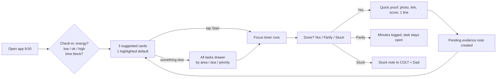

# HQ Dashboard: product spec (draft)

> **Status: draft, nothing built.** Waiting on Dad ([[20261124-learning-dashboard]]). Build plan and web-app research: [[dashboard-build-plan]]. Agent API: [[dashboard-agent-contract]]. Clickable mockup (sample data): `70-dashboard/dashboard-mockup.html`.
> Builds on, and does not replace: [[04-student-dashboard|Doc 04]] (weekly rhythm), [[17-command-center-ui-build-brief|Doc 17]] (the approved "Quiet Charter" look), [[command-center]] (today's read-only HTML snapshot), and the 2026-11-22 entries in [[DECISIONS]] (vault-first; "the Command Center web app waits for v2").

## 1. One-line pitch
**Open it, pick one of three, press Start.** A morning-to-Friday companion that turns the vault Shiloh already has into one calm screen. He picks a task, runs a focus timer, checks it off with proof, and leaves a note. Dad sees the same truth, and he alone verifies it. COLT and Grok Bot read and write the same data through a safe agent API.

## 2. The problem (from evidence, not opinion)
- [[learner-profile]]: the 7th-grade struggle was a **systems and organization gap, not ability**.
- This week, as of 2026-11-24: 0 of 5 missions are checked and there are no daily notes since setup. Last week's Khan total was 16 min against a 215 min/week plan ([[khan-dashboard]]). Constitution 101 scores were 12/12, 6/6 and 13/13, so he can do the work. The hard parts are **starting, sequencing and capturing**.
- The vault holds the right information, but it is spread across 10+ notes. A 14-year-old should not have to read [[NOW]], [[project-priority-board]], [[khan-priority-plan]] and [[shiloh-schedule]] to know what to do at 9:15 AM.

## 3. Users and jobs-to-be-done
| User | Who | Main jobs | Must never |
|---|---|---|---|
| **Learner** | Shiloh, 14, Middle School Completion Year 2026–27, target 9th grade Fall 2027 | "Tell me what to do next, and let me choose." "Help me start and stay on it for 25 minutes." "Let me show I did it without writing a report." "Let me say where I'm stuck without it feeling like failure." | Feel watched, compared, or punished by the tool |
| **Headmaster** | Thomas (Dad) | "In 2 minutes, is he on track for P1 ([[hs-readiness]])?" "What needs my verification or decision?" "What is stuck, and is it a system problem?" | Do data entry, or be surprised on Friday |
| **Agents** | COLT (Shiloh's tutor in Grok Build), DaD / Dad's Chief-of-Staff COLT (Grok Bot) | Read progress, suggest next, start/stop timers on request, file pending evidence, write check-ins | Set `verified`, `decision`, readiness 🟢, or edit [[verifications]] |
| **Future learner** | Shiloh's younger brother | The same system, his own vault, his own quadrants and courses, age-tuned copy | Inherit Shiloh's data, or be compared to him |

## 4. Design principles (youth product + executive-function research)
1. **Choice, not a list.** Show **3 good options**, with one highlighted as the default, plus a "something else" drawer. Too many options stall a teen who already has trouble starting. Zero choice undermines autonomy, a core need in Self-Determination Theory.
2. **Start in one tap.** From opening the app to a running timer takes two taps at most. Every task card has a ready **first physical move** ("Open Khan 7th reading, unit 1, take the unit test").
3. **Make time visible.** Use a shrinking ring, not just numbers. A 2025 CHI study found visual time cues outperform a plain timer on task performance. Timer lengths are 15, 20, 25 or 50 minutes, adjustable ("some days 25 is too much").
4. **Claimed ≠ verified, visibly.** Every item has three states: *done (claimed)*, *evidence attached*, and *verified by Dad*. The app never fakes the third. This mirrors [[AGENTS]] P1.
5. **Consistency over streaks.** Weekly rings ("4 of 5 school days") with built-in grace. **No daily chain that breaks**, no leaderboards, no sibling comparison, no points shop. Streak research shows gains in use, but SDT research warns of overjustification and pressure. Use only informational feedback, such as "you did 3 ELA sittings; 1 to go."
6. **Stuck is data, not failure.** "I'm stuck" is a first-class button. Its copy follows Charter Principle 1: system, not character.
7. **One screen, calm.** Quiet Charter look ([[17-command-center-ui-build-brief|Doc 17]]): warm parchment, hairline cards, quadrant dots, no gradients, no confetti storms. One small, honest celebration when a task is done.
8. **Same truth for Dad and Shiloh.** Shiloh can see everything Dad sees (Doc 03 §6.3: a coaching tool, not surveillance). "Just talking" is never captured. The notes box says what it is for.
9. **Markdown is the source of truth.** If the app disappears, the vault still works in Obsidian. The app writes small, exact edits, never whole rewrites.
10. **Agent-first.** Every action the UI can take is a documented tool an agent can call, with the same permission rules ([[dashboard-agent-contract]]).

## 5. Core flows
### 5.1 Morning: "Pick your mission" (target: under 90 seconds)

- The check-in asks one or two questions (energy, plus "how long is this block?"). The suggester uses the answers. Low energy surfaces shorter, familiar tasks, like math keep-warm, instead of a new unit.
- The first card follows the schedule slot. At 9:15 Mon–Thu, that is Khan ELA 25 per [[khan-priority-plan]], and the card says why: "Planned for this slot · ELA is priority 1 · 2 of 4 sittings this week."

### 5.2 Focus timer
- Full-screen calm mode: ring, task name, first move, a small "parking lot" field for distracting thoughts, a Pause button, and "End early".
- At the end: a soft chime, the 3-way outcome (Done / Partly / Stuck), then a break countdown (5–10 min).
- Writes: one row in today's daily note under `## Focused-time log` (the format in [[20261124-five-hour-schedule]] if approved, otherwise `## Focus sessions`). Also one `timer.stopped` event.
- Survives refresh and closing the laptop, because the running timer is kept in local state with a start time.

### 5.3 Check-off and evidence capture
- **Done** asks for one quick proof: a score ("12/12"), a link, a photo or file dropped in, or one sentence. It's optional but nudged ("Dad can verify faster with proof").
- The app creates a `50-evidence/<quarter>/` note from [[evidence]] with `verified: pending`. It never sets yes. It also ticks the mission in [[NOW]] if the task is a weekly mission.
- **Partly** logs minutes only. **Stuck** opens 5.4.

### 5.4 Notes and "stuck on"
- Three small prompts mirror the daily template: **Did · Learned · Stuck on · Tomorrow's first move**. All of them write to `40-journal/daily/YYYY-MM-DD.md`, created from the template if missing.
- A stuck note on a task adds `stuck: true` and a dated line to that task. It shows up for Dad and COLT. COLT's response is Socratic (ask → hint → explain), never the answer.
- The evening wrap-up asks two questions and drafts the daily note from the day's events. Shiloh edits and saves, which makes 3 daily notes a week nearly free.

### 5.5 Prioritize and due dates
- **Now / Next / Later** lanes, drag to reorder, plus a hard `due` date where one exists. Priority defaults come from [[project-priority-board]] scores. Shiloh can pin up to 2 tasks to the top (autonomy). Only Dad can change the academic weight (W) or required-subject flags.
- Due dates show as plain words ("due Fri", "3 days late") with escalation colors following Doc 06 §4. Nothing turns red at the learner without a next step attached.

### 5.6 Learning map (progress by area)
- Five quadrant rings (Mind, Body, Venture, Spirit, Systems). Tapping one opens its areas: Khan courses (mastery %), HQ courses (units done), readiness gates.
- Every number shows its source and date ("Khan site, synced 2026-11-22"). Missing data shows **—**, never a guess (same rule as `scripts/build_dashboard.py`).

### 5.7 Dad view ("Headmaster")
- The top strip answers one question: **"On track for Fall 2027?"**, showing the three gates from [[hs-readiness]].
- The **Needs you** queue includes:
  - evidence to verify (each pending note, with a "Verify" action that writes a row to [[verifications]] *only from Dad's authenticated parent session*)
  - proposals with `decision: pending` (opens the note in Obsidian)
  - open loops marked "needs Thomas"
- The week at a glance: missions done, daily notes, focused minutes against target, Khan minutes against 215, and stuck items.
- Read-only for agents. Dad's Chief-of-Staff bot can call `get_progress`, but not verify.

### 5.8 Friday review (with Dad, 30 min)
A guided 5-step screen, mirroring the `friday-review` skill:
1. Missions done, partly or not done
2. Minutes and Khan
3. Evidence to verify, which Dad does live
4. Circle scores 0–10
5. Next week's 3–5 missions

It writes a `40-journal/weekly/` note and a status-history snapshot, via the existing skills.

## 6. Screens (wireframes)
### 6.1 Today (learner home)
```
+--------------------------------------------------------------------------+
| Tue Nov 24 · Good morning, Shiloh          Week: ●●○○○ days   [Dad view] |
| Energy?  ( low ) ( ok ) ( HIGH )    Block: 9:15–9:40 · 25 min             |
+--------------------------------------------------------------------------+
| PICK ONE                                                                  |
| +-------------------------+ +----------------------+ +------------------+ |
| | ● MIND · Khan ELA      * | | ● MIND · Science     | | ● SYSTEMS        | |
| | 7th grade reading        | | MS physics: Motion   | | Write a daily    | |
| | First move: take Unit 1  | | & forces 75% -> 80%  | | note (3 this wk) | |
| | test (test out if easy)  | | 25 min               | | 5 min            | |
| | 25 min · 1 of 4 this wk  | |                      | |                  | |
| |        [ START ]         | |  start >             | |  start >         | |
| +-------------------------+ +----------------------+ +------------------+ |
| something else v                                                          |
+--------------------------------------------------------------------------+
| THIS WEEK'S MISSIONS (from NOW)            | DUE SOON                      |
| ○ Set up the PC with Dad                   | Reading baseline · Dad · Fri  |
| ○ First chat with COLT                     | Friday review · Fri 11/27     |
| ◐ Write 3 daily notes (0/3)                |                               |
| ○ Pick the next course                     | STUCK? [ I'm stuck on... ]    |
| ○ Seat one open Knight                     |                               |
+--------------------------------------------------------------------------+
| Minutes today ▓▓░░░░░░ 50/300 (if approved) · Khan this week 25/215       |
+--------------------------------------------------------------------------+
```
### 6.2 Focus
```
+------------------------------------------+
|            KHAN ELA · 7th reading         |
|                 .-""-.                    |
|               /  18:42 \    ring shrinks  |
|               \        /                  |
|                 '-..-'                    |
|  First move: Unit 1 unit test             |
|  Parking lot: [ thought to deal with later ] |
|  [ pause ]   [ end early ]                |
+------------------------------------------+
-> on end:  [ Done ✓ ]  [ Partly ]  [ Stuck ]
-> Done:    Proof? [score] [link] [photo] [1 line]  -> "Saved as pending for Dad"
```
### 6.3 Map
```
 MIND ●●●●●●○○○○  Khan: 7th ELA —  · 8th math 55% · physics 35% · Civ 3 pending
 BODY ●●○○○○○○○○  Gym not started · Hoops (draft, pending Dad)
 VENTURE ●○○○○○○○○  Playbook ongoing · Homeschool OS product (pending)
 SPIRIT  —          no data yet
 SYSTEMS ●●○○○○○○○  Missions 0/5 · daily notes 0/3 · system holds: week 1 of 3
 (every number links to its source note + sync date; — = not in vault)
```
### 6.4 Plan (prioritize and due dates)
```
 NOW (pinned by Shiloh: 1/2)     NEXT                      LATER
 [Khan ELA 4x25]  due Fri        [Civ Unit 0]              [Kitchen course]
 [Write daily note] due today    [MS biology cells 13%]    [Panel course]
 drag to reorder · priority score shown faint · Dad-only: weight W, required flag
```
### 6.5 Dad (Headmaster)
```
 ON TRACK FOR FALL 2027?  Gate1 ⚪ not measurable (no baselines) · Gate2 week 1/3 · Gate3 0/22
 NEEDS YOU (6)
  ⏳ Evidence: Constitution 101 14th Amendment test 12/12   [open] [verify… (parent PIN)]
  ⏳ Evidence: Elections quiz 1 6/6 · unit test 13/13
  ⚖ Proposal: Readiness Examiner · Hoops course · 5-hour schedule · this dashboard
  ! Give Reading baseline diagnostic (P1)
 THIS WEEK: missions 0/5 · notes 0/3 · focused min — / 1500 · Khan 16 last wk / 215 · stuck: 0
 AGENT ACTIVITY: COLT filed 1 pending evidence · DaD check-in 7:00 PM
```
### 6.6 Friday review: a 5-step wizard (see 5.8).

## 7. Data model (Markdown stays the source of truth)
| Concept | Lives in (existing) | Read | Written by app |
|---|---|---|---|
| Weekly missions (max 5) | [[NOW]] `## This week's missions` checkboxes | yes | tick `[ ]`→`[x]` (exact-line edit) |
| Open loops / waiting on Dad | [[NOW]] | yes | no (agents and COLT already maintain it) |
| Workstreams, progress % | [[status-tracker]] table | yes | no (status-update skill owns it) |
| Priority scores | [[project-priority-board]] | yes | no in MVP; v1 writes Shiloh's Interest only |
| Khan minutes, mastery | [[khan-dashboard]], `25-khan/courses/` | yes | no (khan-sync owns it) |
| Schedule slots | [[shiloh-schedule]] (draft times) | yes | no |
| Daily note | `40-journal/daily/YYYY-MM-DD.md` from [[daily]] | yes | create if missing; append to sections |
| Evidence | `50-evidence/YYYY-Qn/` from [[evidence]] | yes | create with `verified: pending` only |
| Verifications | [[verifications]] | yes | **parent session only**, append one row |
| Proposals | `proposals/` | yes | create (`decision: pending`); **never edit `decision`** |
| Readiness gates | [[hs-readiness]] | yes | no (never sets 🟢) |

**New, proposed (needs approval):**
- `45-tasks/` holds one note per task (fits between journal 40 and evidence 50):
```yaml
---
type: task
id: t-20261124-khan-ela-7-unit1
title: "Khan 7th reading: Unit 1 unit test"
status: todo          # todo | doing | done | parked
area: khan-grade-7-reading   # course or workstream note name
quadrant: "[[mind-mastery]]"
lane: now             # now | next | later
pinned: false         # Shiloh may pin up to 2
priority: 6.2         # copied from project-priority-board, display only
due: 2026-11-27
est_min: 25
energy: ok            # low | ok | high: the energy it needs
first_move: "Open Khan 7th grade reading, Unit 1, press Unit test"
mission: true         # mirrors a NOW.md mission line
stuck: false
created_by: colt      # shiloh | thomas | colt | dad-bot | app
evidence: []          # links to 50-evidence notes once filed
---
```
- `.hq/events/YYYY-MM.jsonl` is an append-only machine event log. It is hidden from Obsidian's graph and synced by Obsidian Git. Schema: [[dashboard-agent-contract]].
- `.hq/learner.json` holds per-learner config: name, display name, quadrant labels, Khan course list, weekly targets, school-day hours and age band. This is what makes cloning clean.

**Multi-learner (brother):** **one vault per learner** (`Shiloh HQ`, `<Brother> HQ`), each its own git repo. The app keeps a tiny registry (`learners.json`, outside both vaults). The learner switcher only appears in Dad's session. Cloning means copying the HQ template (structure, skills and templates, with Shiloh's journal, evidence and progress stripped), then a setup wizard fills `learner.json`. This keeps privacy, git history and COLT's token rules simple, and nothing in Shiloh's vault changes.

## 8. Intelligence features
| Feature | How it works (transparent rules first, model second) | Phase |
|---|---|---|
| **Suggest next (3 cards)** | Score = schedule-slot match + due urgency + weekly-minute deficit (e.g. ELA 25/100) + priority board score + quadrant balance − recently-done − energy mismatch. Top 3, each with a "why" line. Deterministic and explainable. | MVP |
| Energy- and time-aware | Low energy or a short block filters to `est_min` ≤ block and familiar tasks. | MVP |
| Draft daily note | Builds Did/Learned/Stuck from the day's events. Shiloh edits before saving. | v1 |
| Khan sync feed | Reads khan-sync output (Friday ~6 PM) to refresh minutes and mastery. No scraping by the app itself. | v1 |
| COLT handoff | "Stuck" → a COLT tutoring session with the task context preloaded (khan-coach / tutor-session skills). | v1 |
| Gentle nudge | If nothing has started 20 min after a block begins, show one kind nudge in the app. Never a push storm. | v1 |
| Weekly pattern insights | For Dad: which slots and tasks get started vs skipped ("science after 10:15 skipped 3 of 4"). Framed as a system tweak. | v2 |
| Evening check-in | DaD's 7 PM weekday routine calls `get_progress` instead of reading 10 files. | v1 |

## 9. Success metrics
| Metric | Target by Friday review 2026-12-18 | Source |
|---|---|---|
| Time from open to timer start (median) | < 2 min | events |
| School days with ≥ 1 focus session | ≥ 4 of 5 | events |
| Daily notes per week | ≥ 3 (NOW mission) | `40-journal/daily/` |
| Khan minutes vs 215/wk plan | ≥ 80% | khan-sync |
| Evidence filed same day as the work | ≥ 70% | evidence `date` vs event |
| Dad verify turnaround | < 7 days | [[verifications]] |
| Gate 2 "system holds" | 3 straight weeks | [[hs-readiness]] |
| Shiloh's own rating, "would use it tomorrow" (1–5) | ≥ 4 | Friday review |
| Agent writes to protected fields | **0** (all blocked and logged) | events |

## 10. Scope
**MVP (a weekend):** Today screen (check-in, 3 cards, all-tasks drawer), focus timer with outcomes, check-off with pending-evidence capture, NOW mission ticks, daily-note notes and stuck, a Plan view with lanes and due dates, a read-only Map, a Dad view with Needs-you queue and parent-only verify, local core API with a CLI and MCP read and write tools, event log, and permission guard.

**Later:** Friday review wizard, daily-note drafting, Khan feed, COLT stuck handoff, tablet PWA on home Wi-Fi, brother clone wizard (v1.5), Tauri desktop packaging, weekly insights, an optional Obsidian side-panel view, and a hosted adapter for the Venture product (v2+, sanitized, never Shiloh's data).

**Not doing:** leaderboards, sibling comparison, points or currency, social features, ads, any public hosting of Shiloh's data, or agents verifying anything.

## 11. Risks and mitigations
| Risk | Mitigation |
|---|---|
| Becomes another idle web app (the Next.js app sat 3 months, per [[DECISIONS]]) | Weekend MVP. The vault works without it. Shiloh co-builds it as Venture Phase 3 ([[shiloh-hq-venture-roadmap]], [[playbook-prototype-cursor]]), so it is his product. |
| Edit conflicts with Obsidian, Obsidian Git or COLT | Atomic writes (temp + rename), exact-line patches, mtime/hash check (If-Match), file watcher reloads, git as backup |
| An agent or prompt injection sets `verified` or `decision` | The guard runs in the core, not in prompts. Protected fields and files are rejected for all non-parent principals and logged. Note text is treated as data. |
| Feels like surveillance | Symmetric visibility. No "just talking" capture. Shiloh owns notes. The Dad view shows systems, not character. |
| Gamification pressure | No breakable streaks, no rewards economy. Feedback is informational only. |
| Screen distraction | Focus mode, a parking lot for distractions, and offline proof (photo) instead of more screen time |
| Local server security | Binds to 127.0.0.1 only, per-principal tokens, Host/Origin checks. LAN or tablet needs pairing (v1.5). No internet exposure. |
| Install friction (Node etc.) | Needs Dad's sign-off (Doc 08 Toolshed). v2 Tauri single installer. |

## 12. Decisions needed from Dad (see [[20261124-learning-dashboard]])
1. Approve building the v2 Command Center now, as a local web app on Shiloh's PC. This revisits the 2026-11-22 "waits for v2" decision.
2. Approve the new `45-tasks/` folder and the hidden `.hq/` event log and config.
3. Approve the app writing [[verifications]] rows **only** from Dad's parent session (PIN or passkey), or keep verification Obsidian-only.
4. Approve installing Node.js LTS on Shiloh's PC (Toolshed rule).
5. Decide whether Shiloh co-builds it as his Venture Phase 3 project, or DaD/COLT build and he reviews.
6. Decide whether the 300 min/day focus target ([[20261124-five-hour-schedule]]) appears in the app, or only Khan's 215/week.
