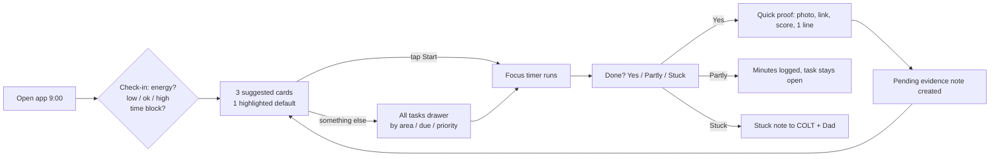

# HQ Dashboard: product spec

> **Status: approved in chat on 2026-11-24** (Dad, talking with DaD). The formal `decision:` field on [[20261124-learning-dashboard]] is still **pending** — only Dad sets that in Obsidian. Nothing is installed or built yet. Co-build guide: [[co-build-guide]]. Build plan: [[dashboard-build-plan]]. Agent API: [[dashboard-agent-contract]]. Clickable mockup (sample data): `70-dashboard/dashboard-mockup.html`.
> Builds on, and does not replace: [[04-student-dashboard|Doc 04]], [[17-command-center-ui-build-brief|Doc 17]] (Quiet Charter tokens still apply; My Day adds a warmer play layer on top), [[command-center]], and the 2026-11-22 [[DECISIONS]] (vault-first). Dad's 2026-11-24 chat decision **reopens** the "Command Center web app waits for v2" deferral; see §12.

## 1. One-line pitch
**Open it, pick one of three, press Start.** A morning-to-Friday companion that turns the vault Shiloh already has into one calm screen. He picks a task, runs a focus timer, checks it off with proof, and leaves a note. Dad sees the same truth, and he alone verifies it. COLT and Grok Bot read and write the same data through a safe agent API.

## 2. The problem (from evidence, not opinion)
- [[learner-profile]]: the 7th-grade struggle was a **systems and organization gap, not ability**.
- This week, as of 2026-11-24: 0 of 5 missions are checked and there are no daily notes since setup. Last week's Khan total was 16 min against a 215 min/week plan ([[khan-dashboard]]). Constitution 101 scores were 12/12, 6/6 and 13/13, so he can do the work. The hard parts are **starting, sequencing and capturing**.
- The vault holds the right information, but it is spread across 10+ notes. A 14-year-old should not have to read [[NOW]], [[project-priority-board]], [[khan-priority-plan]] and [[shiloh-schedule]] to know what to do at 9:15 AM.

## 3. Users and jobs-to-be-done
| User | Who | Main jobs | Must never |
|---|---|---|---|
| **Learner + project manager** | Shiloh, 14, Middle School Completion Year 2026–27, target 9th grade Fall 2027 | "Tell me what to do next, and let me choose." "Help me start and stay on it for 25 minutes." "Let me run my own projects the way adults do — boards, tasks, due dates — and grow into the harder views." "Let me show I did it without writing a report." "Let me say where I'm stuck without it feeling like failure." | Feel watched, compared, or punished; have schoolwork locked behind a level or XP wall |
| **Headmaster** | Thomas (Dad) | "In 2 minutes, is he on track for P1 ([[hs-readiness]])?" "What needs my verification or decision?" "What is stuck, and is it a system problem?" | Do data entry, or be surprised on Friday |
| **Agents** | COLT (Shiloh's tutor in Grok Build), DaD / Dad's Chief-of-Staff COLT (Grok Bot) | Read progress, suggest next, start/stop timers on request, file pending evidence, write check-ins | Set `verified`, `decision`, readiness 🟢, or edit [[verifications]] |
| **Future learner** | Shiloh's younger brother | The same system, his own vault, his own quadrants and courses, age-tuned copy | Inherit Shiloh's data, or be compared to him |

## 4. Design principles (youth product + executive-function research)
1. **Choice, not a list.** Show **3 daily quests**, with one highlighted as the default, plus a "something else" drawer. Too many options stall a teen who already has trouble starting. Zero choice undermines autonomy, a core need in Self-Determination Theory.
2. **Start in one tap.** From opening the app to a running timer takes two taps at most. Every quest card has a ready **first physical move** ("Open Khan 7th reading, unit 1, take the unit test") — Brilliant-style: one bite-size step, not a unit wall.
3. **Make time and progress visible.** A shrinking focus ring, a learning path of unit-nodes, and a weekly ring. Visual cues beat a plain timer (CHI 2025). Timer lengths are 15, 20, 25 or 50 minutes, adjustable ("some days 25 is too much").
4. **Claimed ≠ verified, visibly — and XP does not close the gap.** Every item has three states: *done (claimed)*, *evidence attached*, and *verified by Dad* (certified). XP can be earned for focused minutes and claimed work; **only verified work gets a Certified badge and a bonus**. The app never fakes the third state. This mirrors [[AGENTS]] P1.
5. **Forgiving streaks, never shame.** Weekly rings ("3 of 5 school days started") with **one grace day / streak freeze per week**. No daily chain that "breaks" in red. No leaderboards, no sibling comparison, no points shop, no hearts that punish mistakes, no loss-aversion countdown ("you'll lose your streak at midnight"). Feedback is informational: "you did 3 ELA sittings; 1 to go." Coming back after a miss is celebrated, not scolded.
6. **Stuck is data, not failure.** "I'm stuck" is a first-class button. Its copy follows Charter Principle 1: system, not character. A missed day does not cost XP.
7. **Two faces, one truth — and Shiloh gets the adult tools too.** **My Day** is a warm, Duolingo-inspired path: quests, a skill tree, XP, a friendly COLT mascot, and a short honest celebration on Done (a check burst, an XP pop, a kind line — not a confetti casino). **Shiloh's Board** is his own Monday.com-style workspace (kanban first, then table, calendar, timeline, dependencies, automations, dashboards), unlocked through short Brilliant-style PM lessons — not an XP paywall. Schoolwork is never locked. **Headmaster** (Dad) is the oversight board: Needs-you, verify, P1 gates. Same data, different job. Quiet Charter tokens ([[17-command-center-ui-build-brief|Doc 17]]) still apply: parchment, hairline cards, Lora + Public Sans, quadrant dots.
8. **Same facts for Dad and Shiloh.** Shiloh can see everything Dad sees (Doc 03 §6.3: a coaching tool, not surveillance). "Just talking" is never captured. The notes box says what it is for.
9. **Markdown is the source of truth.** If the app disappears, the vault still works in Obsidian. The app writes small, exact edits, never whole rewrites. XP and badges live in `.hq/` (default; see §12) so they can be rebuilt from events if needed.
10. **Agent-first.** Every action the UI can take is a documented tool an agent can call, with the same permission rules ([[dashboard-agent-contract]]). Agents cannot award "certified" or set `verified`.


## 4.1 The play layer (My Day) — Duolingo + Brilliant, without the traps

Dad asked (2026-11-24, in chat with DaD) that Shiloh's home screen take inspiration from **Duolingo** (path, daily quests, XP, levels, streaks, mascot, celebrations, badges) and **Brilliant.org** (bite-size interactive steps, a visual unit path, progress you can see). The same day he clarified that **Shiloh himself** also needs Monday.com-style project tools (not only Dad), so he can manage his work and learn adult PM habits. Dad's view stays oversight and verify. The rules below keep the fun and drop the manipulation.

| We take | We leave |
|---|---|
| A vertical **learning path** per area; each unit is a node (locked / current / claimed / **certified**) | Leagues, global or sibling leaderboards, "You're #12 in the Diamond League" |
| **Daily quests:** pick 1 of 3 (the existing suggestion engine, with an XP label) | Quest timers that expire and shame you; energy/hearts that block practice |
| **XP** for focused minutes and completed (claimed) tasks; **levels** as a progress label | A points shop, loot boxes, pay-to-win, or XP as a substitute for learning |
| **Certified bonus:** when Dad verifies, the node gets a seal and a bonus XP award | Letting a high XP total look like "the work is done" |
| **Weekly ring + 1 grace day (streak freeze)** per school week | A breakable daily streak, red "you lost it," midnight countdown, guilt-nudge emails |
| A short **celebration** on Done (check burst, XP float, COLT line) | Slot-machine confetti, sound that demands another hit, variable-ratio spam |
| **COLT as mascot:** calm, slightly knightly, one short line. Socratic if stuck. | A nagging mascot, daily "come back or else" |
| **Badges for real milestones** (first 25-min focus, 4 ELA sittings in a week, first Certified quiz, Constitution 101 certified, Gate 2 week holds) | Vanity badges for opening the app, or badges that expire |
| Brilliant-style **first move** on every node: one small step you can start now | A long lesson before any action |

### XP and levels (v1 rules, explainable)
- **1 XP per focused minute** actually logged (Partly and Stuck still count minutes; they just don't complete the quest).
- **+10 XP** for saving a daily note; **+15 XP** for ticking a weekly mission.
- Completing a quest also awards its listed bonus (usually 15–25), not a second copy of the minutes.
- **Certified bonus:** +50% of that quest's XP, awarded only when Dad verifies, plus the Certified seal on the path node. Unverified work stays "claimed" (a filled node, no seal).
- Level = `1 + floor(total XP / 1000)`. Levels never lock content. Path nodes lock only by real prerequisites (finish or test out of Unit 1 before Unit 2), never by a grind wall.
- A missed day costs **0 XP**. A return-after-miss can show a small "welcome back" line, no penalty and no makeup tax.

### Where it lives
Progress totals and badges are written to `.hq/progress.json` and `.hq/events/` (see default in §12). They can always be rebuilt from focus rows, evidence notes, and [[verifications]]. The Headmaster view may show XP as a faint engagement signal; **P1 status uses verified evidence only**.

## 4.2 Shiloh's Board — Monday.com-style PM, unlocked by Skill-up

Dad's clarification (2026-11-24, in chat with DaD): Shiloh should **logically and visually manage his own projects and tasks**, and learn adult tools and processes along the way. He gets boards, a table, a calendar, a timeline, the ability to create projects, break them into tasks and subitems, set status, priority, and due dates, add dependencies, and run a simple weekly planning / review ritual.

This is **progressive disclosure**, not a paywall. My Day and a simple kanban are always there. Harder views unlock when he finishes a short PM-skills lesson (Brilliant-style: 5–8 interactive steps, practiced on his real board). A suggested level is shown ("this usually clicks around Lv 3") but he can start the lesson early. **XP never gates a tool. Schoolwork is never locked.**

| Skill-up | Unlocks | Lesson teaches | When it's offered |
|---|---|---|---|
| **0. Always on** | **My Day** + **Kanban** (Now / Next / Later). Create a task, set status, priority, due date, pin up to 2. | — (the board *is* the lesson) | Day one |
| **1. Break it down** | **Projects** that hold tasks; **subitems** under a task; group the board by project | Chunking work, "done looks like," one next action | After he has used the kanban for a few tasks, or whenever he starts the lesson |
| **2. See the whole table** | **Table view**: Name, Status, Priority, Due, Estimate, Project, Owner. Sort and filter. | Scanning a lot of work, what a column is for | After Skill-up 1, or early if he wants it |
| **3. Plan the week** | **Calendar** view + a 15-minute **Monday plan** and **Friday self-review** ritual (separate from, and feeding, the Friday review with Dad) | Estimating, a weekly sprint, committing to a realistic load | After one week on the board |
| **4. What has to happen first** | **Timeline / Gantt** and **dependencies** (Task B waits on Task A) | Sequencing, "can't start until," a simple critical path | After Skill-up 3 |
| **5. Let the board help you** | Simple **automations**: "when due tomorrow, move to Now"; "when status is done, ask for proof." No nag-storms, no shame pings. | When a rule helps vs. when it nags | After Skill-up 4 |
| **6. Read your week** | **His** dashboard: tasks moved, on-time %, focused minutes, claimed vs certified. (P1 gates stay on Dad's board.) | Which numbers matter, and which are just noise | After Skill-up 5 |

Each lesson ends by doing the thing on a real project (for example: "break 'Pick the next course' into three subitems"). Completing it writes a `pm-skill.unlocked` event and, if it is a real milestone, a badge. Locked view buttons are visible, dimmed, with "Start the 8-minute lesson to unlock" — never "reach Level 8 to continue."

Shiloh may create his own projects (a Venture experiment, a Hoops training block, a book). Course workstreams already in the vault (The Civ, Khan ELA, etc.) appear as projects he does not have to recreate. Only Dad can change academic weight (W) or required-subject flags; Shiloh owns status, due dates, estimates, Interest, pins, and how he breaks the work down.


## 5. Core flows
### 5.1 Morning: My Day — pick a daily quest (target: under 90 seconds)

- The check-in asks one or two questions (energy, plus "how long is this block?"). The suggester uses the answers. Low energy surfaces shorter, familiar tasks, like math keep-warm, instead of a new unit.
- The first quest follows the schedule slot. At 9:15 Mon–Thu, that is Khan ELA 25 per [[khan-priority-plan]], and the card says why: "Planned for this slot · ELA is priority 1 · 1 of 4 sittings this week" plus the XP on offer.
- Under the quests, a **path strip** shows the current area's next 4–6 unit nodes (you-are-here, claimed, certified, locked). Tapping a node opens its first move. COLT's mascot sits in the header with one line ("Pick one. I'll sit with you.").

### 5.2 Focus timer
- Full-screen calm mode: ring, task name, first move, a small "parking lot" field for distracting thoughts, a Pause button, and "End early".
- At the end: a soft chime, the 3-way outcome (Done / Partly / Stuck), then a break countdown (5–10 min).
- Writes: one row in today's daily note under `## Focused-time log` (the format in [[20261124-five-hour-schedule]] if approved, otherwise `## Focus sessions`). Also one `timer.stopped` event.
- Survives refresh and closing the laptop, because the running timer is kept in local state with a start time.

### 5.3 Check-off and evidence capture
- **Done** asks for one quick proof: a score ("12/12"), a link, a photo or file dropped in, or one sentence. It's optional but nudged ("Dad can verify faster with proof").
- A short celebration plays: check burst, XP pop, COLT line ("Nice. It's pending for Dad."). Then back to My Day, with the path node filled in as *claimed*.
- The app creates a `50-evidence/<quarter>/` note from [[evidence]] with `verified: pending`. It never sets yes. It also ticks the mission in [[NOW]] if the task is a weekly mission.
- When Dad later verifies from the Headmaster view, the node gains a **Certified** seal and the bonus XP is awarded (an event, no fake retroactive "you already had this").
- **Partly** logs minutes (and their XP) only. **Stuck** opens 5.4. Neither is a punishment.

### 5.4 Notes and "stuck on"
- Three small prompts mirror the daily template: **Did · Learned · Stuck on · Tomorrow's first move**. All of them write to `40-journal/daily/YYYY-MM-DD.md`, created from the template if missing.
- A stuck note on a task adds `stuck: true` and a dated line to that task. It shows up for Dad and COLT. COLT's response is Socratic (ask → hint → explain), never the answer.
- The evening wrap-up asks two questions and drafts the daily note from the day's events. Shiloh edits and saves, which makes 3 daily notes a week nearly free.

### 5.5 Shiloh's Board (projects, tasks, views, weekly ritual)
- **Always: Kanban** with **Now / Next / Later** lanes. Drag to reorder. Each card shows status, priority, due date, estimate, and (once Skill-up 1 is on) subitem progress. Priority defaults come from [[project-priority-board]] scores; Shiloh can pin up to 2. Only Dad changes academic weight (W) or required-subject flags.
- **Create:** a **New task** button (always) and a **New project** button (after Skill-up 1, or earlier with the lesson). A project has a name, quadrant, a one-line outcome, and a list of tasks. Tasks can have **subitems**. Course workstreams already in the vault show up as projects automatically.
- Due dates show as plain words ("due Fri", "3 days late") with escalation colors following Doc 06 §4. Nothing turns red without a next step attached.
- **View switcher** (Skill-up 2–6): Table, Calendar, Timeline, then a simple automations pane and his dashboard. Locked views are visible and teachable, not hidden.
- **Dependencies** (Skill-up 4): a task can wait on one or more others. The kanban marks "waiting on…"; the timeline draws the link. Cycles are rejected with a plain explanation.
- **Monday plan (15 min):** look at the board, pick or confirm this week's 3–5 missions, give each a first move and an estimate, and place them on Now / the calendar. Writes to a day-plan note and can tick into [[NOW]].
- **Friday self-review (10 min, before or during the review with Dad):** walk missions (done / partly / not done), carry over without shame, and note one system tweak. Feeds §5.8.

### 5.6 Learning map (progress by area)
- Five quadrant rings (Mind, Body, Venture, Spirit, Systems). Tapping one opens that area's **full skill path** (units as nodes: locked / current / claimed / certified) plus mastery % and HQ-course units.
- Every number shows its source and date ("Khan site, synced 2026-11-22"). Missing data shows **—**, never a guess (same rule as `scripts/build_dashboard.py`).
- Badges earned sit at the bottom of the map, each with the date and the evidence or verification that unlocked it.

### 5.7 Dad view ("Headmaster") — Monday.com-style
- The top strip answers one question: **"On track for Fall 2027?"**, showing the three gates from [[hs-readiness]]. This strip is a project status, not a game HUD. XP may appear as a small "engagement this week" note; it does not move a gate.
- A **board** with groups (like Monday.com): **Needs verify**, **Pending proposals**, **Open loops**, **This week's work**. Columns: item, status, owner, due, last activity, proof. Status pills: pending / certified / needs-redo / waiting.
- **Needs verify:** each pending evidence note, with a "Verify" action that writes a row to [[verifications]] *only from Dad's PIN-unlocked human parent session* (chat decision, 2026-11-24). Same action sets `verified: yes` on the evidence note and awards the Certified bonus. Agents cannot do this.
- Proposals with `decision: pending` open the note in Obsidian. The app still never writes `decision:`.
- The week at a glance: missions done, daily notes, focused minutes against target, Khan minutes against 215, stuck items, and (faint) XP earned.
- Read-only for agents. Dad's Chief-of-Staff bot can call `get_progress`, but not verify.

### 5.8 Friday review (with Dad, 30 min)
A guided 5-step screen, mirroring the `friday-review` skill, and using Shiloh's self-review if he already ran it:
1. Missions done, partly or not done (from the board)
2. Minutes and Khan
3. Evidence to verify, which Dad does live
4. Circle scores 0–10
5. Next week's 3–5 missions (can start the Monday plan early)

It writes a `40-journal/weekly/` note and a status-history snapshot, via the existing skills.

## 6. Screens (wireframes)
### 6.1 My Day (learner home)
```
+--------------------------------------------------------------------------+
| Tue Nov 24 · Good morning, Shiloh     Lv 4  840/1000 XP            |
|  [COLT mascot] "Pick one quest. I'll sit with you."                      |
|  Week ring ●●○◇○  2 of 5 started · 1 grace left   (never a broken chain) |
+--------------------------------------------------------------------------+
| DAILY QUESTS — pick one                                                  |
| +-------------------------+ +----------------------+ +------------------+ |
| | ● MIND · +25 XP        * | | ● MIND · +25 XP      | | ● SYSTEMS +10 XP | |
| | 7th grade reading        | | MS physics: Motion   | | Write a daily    | |
| | First move: take Unit 1  | | & forces, next quiz  | | note (3 this wk) | |
| | test (test out if easy)  | | 25 min               | | 5 min            | |
| | 25 min · 1 of 4 this wk  | |                      | |                  |
| |        [ START ]         | |  start >             | |  start >         | |
| +-------------------------+ +----------------------+ +------------------+ |
| something else v                                                         |
+--------------------------------------------------------------------------+
| YOUR PATH · Mind · 7th grade reading                                     |
|  (cert) Unit 0   (you) Unit 1    ( ) Unit 2    (lock) Unit 3             |
|   certified       current         locked until Unit 1                    |
|  Constitution 101 ████████░░ 90%  · 3 quizzes claimed, 0 certified      |
+--------------------------------------------------------------------------+
| MISSIONS (from NOW)  ○○○○○ 0/5     | DUE SOON  ·  STUCK?  ·  notes box   |
| Khan this week  0/215 (approved)   | Focus today  0/300 (proposed)       |
+--------------------------------------------------------------------------+
```
### 6.2 Focus
```
+------------------------------------------+
|            KHAN ELA · 7th reading         |
|                 .-""-.                    |
|               /  18:42 \    ring shrinks  |
|               \        /                  |
|                 '-..-'                    |
|  First move: Unit 1 unit test             |
|  Parking lot: [ thought to deal with later ] |
|  [ pause ]   [ end early ]                |
+------------------------------------------+
-> on end:  [ Done ✓ ]  [ Partly ]  [ Stuck ]
-> Done:    Proof? [score] [link] [photo] [1 line]  -> "Saved as pending for Dad"
```
### 6.3 Map (full paths + badges)
```
 MIND  path: 7th ELA  Unit0 cert · Unit1 you-are-here · Unit2 locked
       8th math 55% · physics 35% · Civ 0 units · Const. 101 90% (3 claimed, 0 certified)
 BODY  Gym not started · Hoops (draft, pending Dad)
 VENTURE  Playbook ongoing · Homeschool OS product (pending)
 SPIRIT  —  no data yet
 SYSTEMS  Missions 0/5 · daily notes 0/3 · system holds: week 1 of 3
 BADGES  (empty slots until earned)  First focus · First certified · ELA week
 (every number links to its source note + sync date; — = not in vault)
```
### 6.4 Shiloh's Board (kanban, always on; other views via Skill-up)
```
 SKILL-UP  [1 Break it down · start lesson]  2 Table  3 Week plan  4 Timeline  5 Auto  6 Dashboard
 Views:  [ Kanban ]  Table (locked)  Calendar (locked)  Timeline (locked)
 [ + New task ]   [ + New project (after lesson 1) ]    Group: All projects v

 NOW (pinned 1/2)                NEXT                         LATER
 [Khan ELA · Unit 1 test]        [Civ Unit 0]                 [Kitchen kickoff]
  due Fri · 25m · P 6.2           50m · P 6.0                  25m
  [start]                         first move: read brief
 [Daily note] due today
 drag cards · subitems appear after Skill-up 1
```
A locked view, clicked, opens the 8-minute PM lesson — not a "level up first" wall.

### 6.5 Dad (Headmaster) — oversight board
```
 ON TRACK FOR FALL 2027?  Gate1 ⚪ not measurable (no baselines) · Gate2 week 1/3 · Gate3 0/22
 Engagement this week (not a gate): 0 XP · 0 of 5 days started

 GROUP            ITEM                                         STATUS      DUE        ACTION
 Needs verify     Const. 101 14th Amendment unit test 12/12    pending     11-16      [verify (PIN)]
                  Elections quiz 1  6/6                        pending     11-17      [verify]
                  Elections unit test 13/13                    pending     11-18      [verify]
 Pending proposals  Readiness Examiner · Hoops · 5-hour · Dash  pending     Fri 11/27  open in Obsidian
 Open loops       Reading baseline diagnostic (P1)             needs Dad   this week  —
                  Confirm Fall 2027 start + L3 targets         needs Dad   —          —
 This week        Missions 0/5 · notes 0/3 · Khan 0/215        in progress Fri 11/27  —

 Verify writes a row to verifications.md from the PIN session only. Certified seal + bonus XP follow.
```
### 6.6 Friday review: a 5-step wizard (see 5.8).

## 7. Data model (Markdown stays the source of truth)
| Concept | Lives in (existing) | Read | Written by app |
|---|---|---|---|
| Weekly missions (max 5) | [[NOW]] `## This week's missions` checkboxes | yes | tick `[ ]`→`[x]` (exact-line edit) |
| Open loops / waiting on Dad | [[NOW]] | yes | no (agents and COLT already maintain it) |
| Workstreams, progress % | [[status-tracker]] table | yes | no (status-update skill owns it) |
| Priority scores | [[project-priority-board]] | yes | no in MVP; v1 writes Shiloh's Interest only |
| Khan minutes, mastery | [[khan-dashboard]], `25-khan/courses/` | yes | no (khan-sync owns it) |
| Schedule slots | [[shiloh-schedule]] (draft times) | yes | no |
| Daily note | `40-journal/daily/YYYY-MM-DD.md` from [[daily]] | yes | create if missing; append to sections |
| Evidence | `50-evidence/YYYY-Qn/` from [[evidence]] | yes | create with `verified: pending` only |
| Verifications | [[verifications]] | yes | **parent session only**, append one row |
| Proposals | `proposals/` | yes | create (`decision: pending`); **never edit `decision`** |
| Readiness gates | [[hs-readiness]] | yes | no (never sets 🟢) |

**Default (not yet decided by Dad; recommended default as of 2026-11-24):** use a new `45-tasks/` folder and a hidden `.hq/` folder when building starts. Dad can still decline; the fallback is to keep missions only in [[NOW]] and skip a per-task note. These folders are **not created until build Session 2**, and not without a mention in the co-build guide.

- `45-tasks/projects/<id>.md` holds one note per project (Skill-up 1). Vault workstreams (The Civ, Khan ELA, …) are mirrored, not duplicated, via a `source` link.
- `45-tasks/` holds one note per task (fits between journal 40 and evidence 50):
```yaml
---
type: task
id: t-20261124-khan-ela-7-unit1
title: "Khan 7th reading: Unit 1 unit test"
status: todo          # todo | doing | done | parked | waiting
area: khan-grade-7-reading   # course or workstream note name
project: "[[khan-grade-7-reading]]"
parent:               # task id, if this is a subitem
depends_on: []        # task ids (Skill-up 4)
quadrant: "[[mind-mastery]]"
lane: now             # now | next | later
pinned: false         # Shiloh may pin up to 2
priority: 6.2         # copied from project-priority-board, display only
due: 2026-11-27
est_min: 25
energy: ok            # low | ok | high: the energy it needs
first_move: "Open Khan 7th grade reading, Unit 1, press Unit test"
mission: true         # mirrors a NOW.md mission line
stuck: false
created_by: colt      # shiloh | thomas | colt | dad-bot | app
evidence: []          # links to 50-evidence notes once filed
---
```
- `.hq/events/YYYY-MM.jsonl` is an append-only machine event log. It is hidden from Obsidian's graph and synced by Obsidian Git. Schema: [[dashboard-agent-contract]]. Includes `xp.earned`, `badge.awarded`, `quest.completed`, `node.certified`, `pm-skill.unlocked`, `project.created`.
- `.hq/learner.json` holds per-learner config: name, display name, quadrant labels, Khan course list, weekly targets, school-day hours and age band. This is what makes cloning clean.
- `.hq/progress.json` holds XP total, level, weekly ring, grace-day used, badges, and **which PM Skill-ups are unlocked**. Rebuildable from events + [[verifications]].

**Multi-learner (brother):** **one vault per learner** (`Shiloh HQ`, `<Brother> HQ`), each its own git repo. The app keeps a tiny registry (`learners.json`, outside both vaults). The learner switcher only appears in Dad's session. Cloning means copying the HQ template (structure, skills and templates, with Shiloh's journal, evidence and progress stripped), then a setup wizard fills `learner.json`. This keeps privacy, git history and COLT's token rules simple, and nothing in Shiloh's vault changes.

## 8. Intelligence features
| Feature | How it works (transparent rules first, model second) | Phase |
|---|---|---|
| **Suggest next (3 cards)** | Score = schedule-slot match + due urgency + weekly-minute deficit (e.g. ELA 25/100) + priority board score + quadrant balance − recently-done − energy mismatch. Top 3, each with a "why" line. Deterministic and explainable. | MVP |
| Energy- and time-aware | Low energy or a short block filters to `est_min` ≤ block and familiar tasks. | MVP |
| Draft daily note | Builds Did/Learned/Stuck from the day's events. Shiloh edits before saving. | v1 |
| Khan sync feed | Reads khan-sync output (Friday ~6 PM) to refresh minutes and mastery. No scraping by the app itself. | v1 |
| COLT handoff | "Stuck" → a COLT tutoring session with the task context preloaded (khan-coach / tutor-session skills). | v1 |
| Gentle nudge | If nothing has started 20 min after a block begins, show one kind nudge in the app. Never a push storm. | v1 |
| Weekly pattern insights | For Dad: which slots and tasks get started vs skipped ("science after 10:15 skipped 3 of 4"). Framed as a system tweak. | v2 |
| Evening check-in | DaD's 7 PM weekday routine calls `get_progress` instead of reading 10 files. | v1 |

## 9. Success metrics
| Metric | Target by Friday review 2026-12-18 | Source |
|---|---|---|
| Time from open to timer start (median) | < 2 min | events |
| School days with ≥ 1 focus session | ≥ 4 of 5 | events |
| Daily notes per week | ≥ 3 (NOW mission) | `40-journal/daily/` |
| Khan minutes vs 215/wk plan | ≥ 80% | khan-sync |
| Evidence filed same day as the work | ≥ 70% | evidence `date` vs event |
| Dad verify turnaround | < 7 days | [[verifications]] |
| Gate 2 "system holds" | 3 straight weeks | [[hs-readiness]] |
| Shiloh's own rating, "would use it tomorrow" (1–5) | ≥ 4 | Friday review |
| Agent writes to protected fields | **0** (all blocked and logged) | events |

## 10. Scope
**MVP (co-built in short sessions, [[co-build-guide]]):** My Day home (check-in, 3 daily quests with XP, COLT mascot, path strip, weekly ring with grace), focus timer with outcomes, check-off with pending-evidence capture and a short celebration, NOW mission ticks, daily-note notes and stuck, **Shiloh's Board** with always-on kanban (create task, status, priority, due dates) and the Skill-up 1 lesson (projects + subitems) if there is time, a read-only Map of full paths, a Monday.com-style Dad oversight view with Needs-you board and PIN-only verify (Certified seal + bonus XP), local core API with a CLI and MCP tools, event log, permission guard, and the XP/level/badge rules in §4.1.

**Later (v1 Skill-ups 2–6, still in the co-build guide):** table view, calendar + Monday/Friday planning ritual, timeline and dependencies, simple automations, Shiloh's own dashboard, Friday review wizard with Dad, daily-note drafting, Khan feed, COLT stuck handoff.

**Later still:** tablet PWA on home Wi-Fi, brother clone wizard (v1.5), Tauri desktop packaging, weekly insights, an optional Obsidian side-panel view, and a hosted adapter for the Venture product (v2+, sanitized, never Shiloh's data).

**Not doing:** leaderboards, sibling comparison, points or currency, social features, ads, any public hosting of Shiloh's data, or agents verifying anything.

## 11. Risks and mitigations
| Risk | Mitigation |
|---|---|
| Becomes another idle web app (the Next.js app sat 3 months, per [[DECISIONS]]) | Weekend MVP. The vault works without it. Shiloh co-builds it as Venture Phase 3 ([[shiloh-hq-venture-roadmap]], [[playbook-prototype-cursor]]), so it is his product. |
| Edit conflicts with Obsidian, Obsidian Git or COLT | Atomic writes (temp + rename), exact-line patches, mtime/hash check (If-Match), file watcher reloads, git as backup |
| An agent or prompt injection sets `verified` or `decision` | The guard runs in the core, not in prompts. Protected fields and files are rejected for all non-parent principals and logged. Note text is treated as data. |
| Feels like surveillance | Symmetric visibility. No "just talking" capture. Shiloh owns notes and his board. The Dad view shows systems, not character. |
| PM tools feel like a second job, or Skill-up feels like a paywall | My Day stays the morning default. Kanban is enough to run a week. Lessons are 5–8 minutes on real work. Views unlock by lesson, not by an XP wall. Schoolwork is never locked. |
| Gamification pressure or "I chased XP, not the work" | Forgiving weekly rings, no leaderboards, no shop, no hearts. XP is a label, never a gate. Certified work is visually distinct. Dad's board ignores XP when scoring P1. |
| Install friction (Node etc.) | Node.js LTS is **already installed** on Shiloh's PC (`v24.18.1`, LTS Krypton, checked 2026-11-24). VS Code is not; Session 0 installs it with Dad. v2 Tauri later. |
| Screen distraction | Focus mode, a parking lot for distractions, and offline proof (photo) instead of more screen time |
| Local server security | Binds to 127.0.0.1 only, per-principal tokens, Host/Origin checks. LAN or tablet needs pairing (v1.5). No internet exposure. |

## 12. Decisions (2026-11-24)

Dad decided these **in chat with DaD** on 2026-11-24. They are recorded here so the co-build can start. The formal `decision:` field on [[20261124-learning-dashboard]] is still `pending` — **only Dad changes that field** in Obsidian (Meta Bind). A chat message does not edit the proposal file.

| # | Question | Decision | Notes |
|---|---|---|---|
| 1 | Build the v2 Command Center now, as a local web app on Shiloh's PC? | **Yes — build now.** | Reopens the 2026-11-22 [[DECISIONS]] line that "the Command Center web app waits for v2." |
| 2 | New `45-tasks/` folder and hidden `.hq/` event log / config / progress? | **Still open.** **Default: yes, use both.** | Needed for per-task notes, the event log, XP, and badges. Not created until Session 2 of [[co-build-guide]]. Dad can still decline. |
| 3 | Where does verifying happen? | **In the app, behind Dad's PIN.** | The app may write rows to [[verifications]] and set `verified: yes` **only** from a PIN-unlocked *human* parent session. Agents still never can. |
| 4 | Install Node.js LTS on Shiloh's PC? | **Yes, approved.** | Check on 2026-11-24: **already installed** — `v24.18.1` (LTS Krypton, 64-bit) at `C:\Program Files\nodejs\node.exe`, npm 12.0.2. Session 0 does not reinstall it. |
| 5 | Who builds it? | **Shiloh co-builds it as his Venture project**, with an AI helper and Dad as reviewer. | Guide: [[co-build-guide]]. Ties to [[shiloh-hq-venture-roadmap]] / [[playbook-prototype-cursor]] (and to [[20261124-venture-shiloh-hq-product]], which is a separate pending proposal). |
| 6 | Show the 300 min/day focus target ([[20261124-five-hour-schedule]])? | **Still open.** **Default: show it as proposed.** | The approved **Khan 215 min/week** ring is always official. The 300 min/day bar appears labeled *proposed — pending the 5-hour schedule proposal*, so the 5-hour idea is visible without treating it as decided. |
| 7 | *(added same day)* My Day play layer: Duolingo + Brilliant inspiration; Dad's view stays Monday.com-style. | **Yes, from Dad in chat.** | Forgiving streaks, XP, path, quests, mascot, badges, short celebrations. No leaderboards, no shame, XP ≠ verified. Details in §4.1. |
| 8 | *(clarified same day)* Shiloh also gets Monday.com-style PM tools, not only Dad, with Skill-up unlocks and short PM lessons. | **Yes, from Dad in chat.** | Kanban on day one. Table, calendar, timeline, dependencies, automations, and his dashboard unlock by lesson (not XP). Dad keeps the oversight / verify view. Details in §4.2. |

**Still for Dad, when he has a minute:** set `decision:` on the proposal; confirm or change the two defaults (#2 and #6); sit with Shiloh for Session 0 if VS Code needs installing (it was not on the PC as of 2026-11-24).
